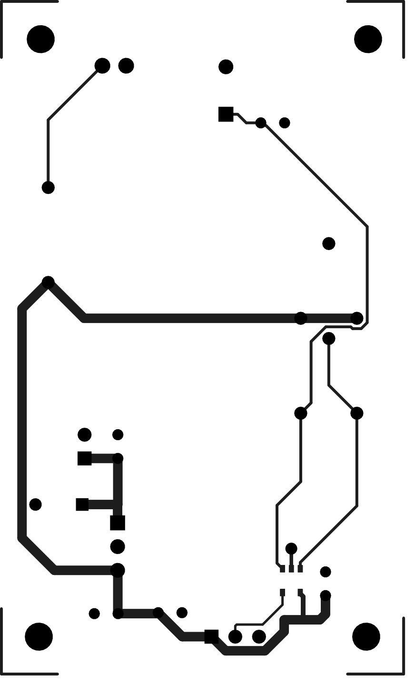

# Digitalni brzinomjer

Projekt iz predmeta PES (FER). Ovo je digitalni brzinomjer s infracrvenim senzorom i dvoznamenkastim 7-segmentnim zaslonom, napravljen u Altium Designeru. Sklop je podijeljen na dvije tiskane pločice, svaka u svom Altium projektu:

| Mapa | Pločica | Dimenzije |
|---|---|---|
| `Brzinomjer_1/` | Senzorska pločica: IR LED (TSAL6200), fototranzistor, pojačalo LM321 i regulator 5 V (LM341) | 43 × 72 mm |
| `Brzinomjer_2/` | Pločica s brojilom i zaslonom: tajmer, dekadska brojila, registri, BCD dekoderi i dva 7-segmentna zaslona | 113 × 60 mm |

## Shema


Princip rada: tajmer daje vremenska vrata, dekadska brojila broje impulse s fototranzistora unutar tih vrata, a rezultat se upisuje u registre i preko BCD/7-segmentnih dekodera prikazuje na zaslonu.

## Tiskane pločice

| Pločica s brojilom i zaslonom | Senzorska pločica |
|---|---|
|  |  |
|  |  |

Cijeli crteži za izradu (slojevi, bušenje, dimenzije) su u `docs/Brzinomjer_1_izrada.pdf` i `docs/Brzinomjer_2_izrada.pdf`.

## Struktura repozitorija

```
Brzinomjer_1/   Altium projekt senzorske pločice (Brzinomjer_1.PrjPcb)
Brzinomjer_2/   Altium projekt pločice s brojilom i zaslonom (Brzinomjer_2.PrjPcb)
docs/           slike i PDF crteži za izradu
```

## Popis komponenti (BOM)

BOM s kataloškim brojevima i cijenama (DigiKey) je u [`Brzinomjer_2/DZ1_Rosandic_Lovro.xlsx`](Brzinomjer_2/DZ1_Rosandic_Lovro.xlsx).

## Autor

Lovro Rosandić, FER
