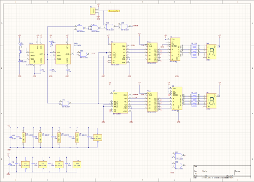
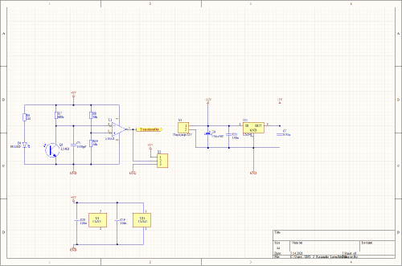
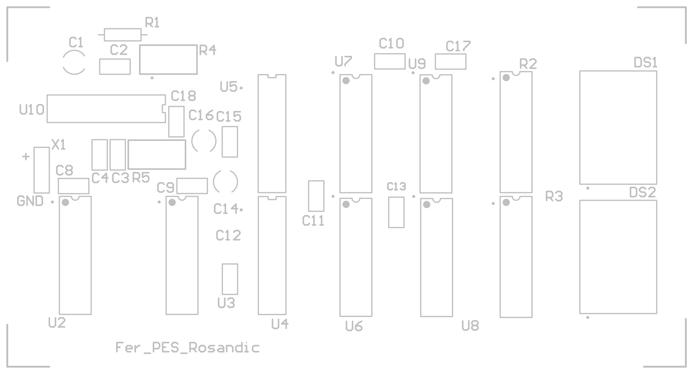
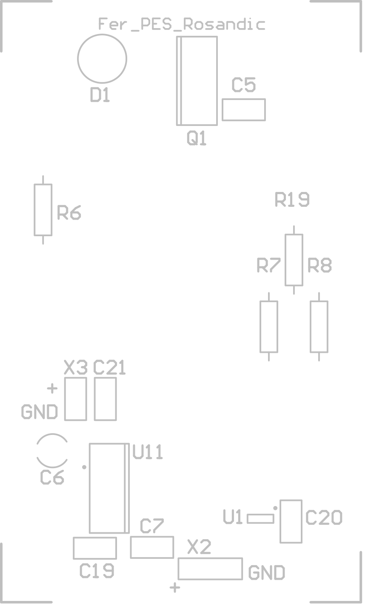
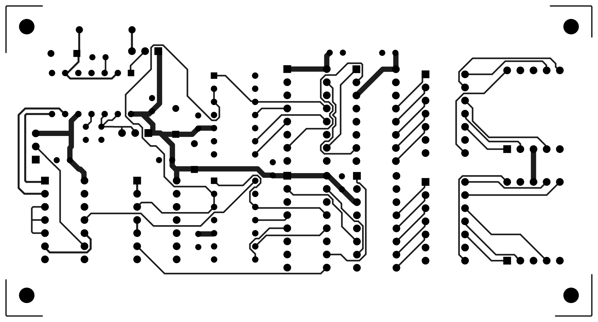

# Digitalni brzinomjer

Projekt iz predmeta PES (FER). Ovo je digitalni brzinomjer s infracrvenim senzorom i dvoznamenkastim 7-segmentnim zaslonom, napravljen u Altium Designeru. Sklop je podijeljen na dvije tiskane pločice, svaka u svom Altium projektu:

| Mapa | Pločica | Dimenzije |
|---|---|---|
| `Senzorska_plocica/` | IR LED (TSAL6200), fototranzistor, pojačalo LM321 i regulator 5 V (LM341) | 43 × 72 mm |
| `Plocica_brojilo_zaslon/` | Tajmer, dekadska brojila, registri, BCD dekoderi i dva 7-segmentna zaslona | 113 × 60 mm |

## Sheme



Princip rada: tajmer daje vremenska vrata, dekadska brojila broje impulse s fototranzistora unutar tih vrata, a rezultat se upisuje u registre i preko BCD/7-segmentnih dekodera prikazuje na zaslonu.



## Tiskane pločice

| Pločica s brojilom i zaslonom | Senzorska pločica |
|---|---|
|  |  |
|  |  |

Cijeli crteži za izradu (slojevi, bušenje, dimenzije) su u `docs/Senzorska_plocica_izrada.pdf` i `docs/Plocica_brojilo_zaslon_izrada.pdf`.

## Struktura repozitorija

```
Senzorska_plocica/        Altium projekt senzorske pločice (Senzorska_plocica.PrjPcb)
Plocica_brojilo_zaslon/   Altium projekt pločice s brojilom i zaslonom (Plocica_brojilo_zaslon.PrjPcb)
docs/                     slike i PDF crteži za izradu
```

## Popis komponenti (BOM)

BOM s kataloškim brojevima i cijenama (DigiKey) je u [`Plocica_brojilo_zaslon/BOM_brzinomjer.xlsx`](Plocica_brojilo_zaslon/BOM_brzinomjer.xlsx).

## Autor

Lovro Rosandić, FER
